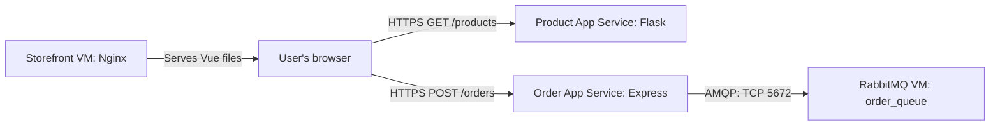

# Lab 3 - CST8915 Full-stack Cloud-native Development

**Student:** David Yin (041289921)

This repository contains my Lab 3 submission for deploying the Algonquin Pet Store on Azure. I deployed the Node.js order-service and a Python rewrite of product-service on Azure App Service. RabbitMQ runs on a dedicated Azure VM, and the Vue.js store-front runs on a separate Ubuntu VM using Nginx.

## Demo Video

[Watch the demo on YouTube](https://youtu.be/VRAbVTyjBuw)

The demonstration is limited to five minutes. My recording outline and submission checklist are in [DEMO.md](DEMO.md).

## Service Repositories

| Service | Implementation | Repository |
| --- | --- | --- |
| order-service | Node.js / Express | [CST8915-lab02-order-service](https://github.com/yanky65/CST8915-lab02-order-service) |
| product-service | Python / Flask, rewritten from Rust | [CST8915-lab02-product-service](https://github.com/yanky65/CST8915-lab02-product-service) |
| store-front | Vue.js | [CST8915-lab02-store-front](https://github.com/yanky65/CST8915-lab02-store-front) |

The service repositories retain their Lab 2 names and contain the Lab 3 updates. This repository holds the submission documentation.

## Deployment

| Component | Azure hosting | Purpose |
| --- | --- | --- |
| store-front | Ubuntu VM with Nginx | Serves the compiled Vue application over HTTP |
| order-service | App Service: `dy-lab3-order-service` | Accepts `POST /orders` and publishes orders to RabbitMQ |
| product-service | App Service: `dy-lab3-product-service` | Returns the product catalog through `GET /products` |
| RabbitMQ | Dedicated Ubuntu VM | Stores orders in the durable `order_queue` queue |

| Application address | Value |
| --- | --- |
| Storefront | [Open the storefront](http://172.183.67.200) |
| Order API base URL | [dy-lab3-order-service](https://dy-lab3-order-service-e0dfa0ewh5gpcgb3.northcentralus-01.azurewebsites.net) |
| Product API base URL | [dy-lab3-product-service](https://dy-lab3-product-service-bseqguadf8a0d2d7.northcentralus-01.azurewebsites.net) |
| RabbitMQ VM | `20.98.62.248` (AMQP port `5672`; management access through an SSH tunnel) |

To view the catalog directly, open [GET /products](https://dy-lab3-product-service-bseqguadf8a0d2d7.northcentralus-01.azurewebsites.net/products). Orders are submitted to `POST /orders` on the order API; opening its base URL in a browser does not test that endpoint.

The browser downloads the frontend from Nginx, then calls the two App Service APIs directly. The order-service connects to RabbitMQ over AMQP. The product-service returns the same three products and numeric prices as the original Rust implementation. No order-processing consumer is included, so successfully published orders remain queued.

### Approved Static Web Apps Alternative

Azure blocked creation of my Static Web App because of the region policy applied to my student subscription. Following the instructor's email approving a VM-based alternative without penalty, I deployed store-front on an Ubuntu VM using Nginx. Both backend services remain on Azure App Service, and RabbitMQ remains on its dedicated VM.

### Deployment and Configuration Details

- **Backend deployment:** Each backend repository has a GitHub Actions workflow that authenticates to Azure using OpenID Connect. Because the application files are inside `order-service/` or `product-service/`, the workflows package the files from those folders at the root of the deployment ZIP. The Python package contains only `app.py` and `requirements.txt`.
- **App Service configuration:** `SCM_DO_BUILD_DURING_DEPLOYMENT=true` enables dependency installation on Azure. The order-service reads `RABBITMQ_CONNECTION_STRING` from App Service settings and listens on the platform-provided `PORT`. Python runs through Gunicorn with `app:app` as its application target.
- **Frontend deployment:** On the storefront VM, `npm ci --include=dev` installs dependencies and `npm run build` creates `dist/`. Nginx serves those files from `/var/www/store-front`.
- **Frontend configuration:** A git-ignored `.env.production.local` supplies `VUE_APP_ORDER_SERVICE_URL` and `VUE_APP_PRODUCT_SERVICE_URL`. These are HTTPS base URLs without trailing slashes. Vue embeds them during the build, so changing a URL requires rebuilding and copying the new output to Nginx.
- **RabbitMQ access:** The order-service uses a dedicated `orderapp` account. The RabbitMQ VM's NSG permits TCP 5672 from the order App Service's outbound IP addresses. The management dashboard is accessed through an SSH tunnel.

RabbitMQ credentials remain in backend settings and are not included in frontend variables, source control, or the demo recording.

## Reflection Questions

### 1. Challenges configuring GitHub Actions environment variables

The main challenge was distinguishing frontend build-time configuration from backend runtime configuration. Static Web Apps creation was blocked by my subscription policy, so I did not complete a successful frontend deployment through its GitHub Actions workflow. Instead, I supplied the two `VUE_APP_*` API URLs in `.env.production.local` on the VM before building. Backend configuration, including the RabbitMQ connection string, stayed in App Service settings. I also adjusted the backend workflows to package the nested service folders correctly so Azure could find their dependency files.

### 2. App Service deployment compared with local execution

Locally, I install dependencies and start each service from a terminal. App Service manages the hosting environment, provides HTTPS endpoints, and runs the application using its configured runtime and startup command. I still need to provide the correct deployment package, dependencies, and environment variables. Moving the order-service also changed its network location: RabbitMQ needed to allow the App Service's outbound IP addresses. Troubleshooting on Azure also involves checking deployment logs and the App Service Log stream instead of relying only on a local terminal.

### 3. The role of environment variables in cloud configuration

Environment variables let the same source code use different ports, service URLs, and backing services across environments. For this lab, I could point the order-service at the recreated RabbitMQ VM by updating its connection string rather than editing the application. Keeping credentials in backend settings also avoids committing them to GitHub, although they still require appropriate access controls. Frontend variables are different: Vue embeds them in publicly accessible JavaScript, so they should contain public API URLs rather than secrets.

## Lab Reference

[Lab 3 assignment](https://github.com/ramymohamed10/26F_CST8915_Lab3). The frontend VM exception was provided separately in the instructor's email.
